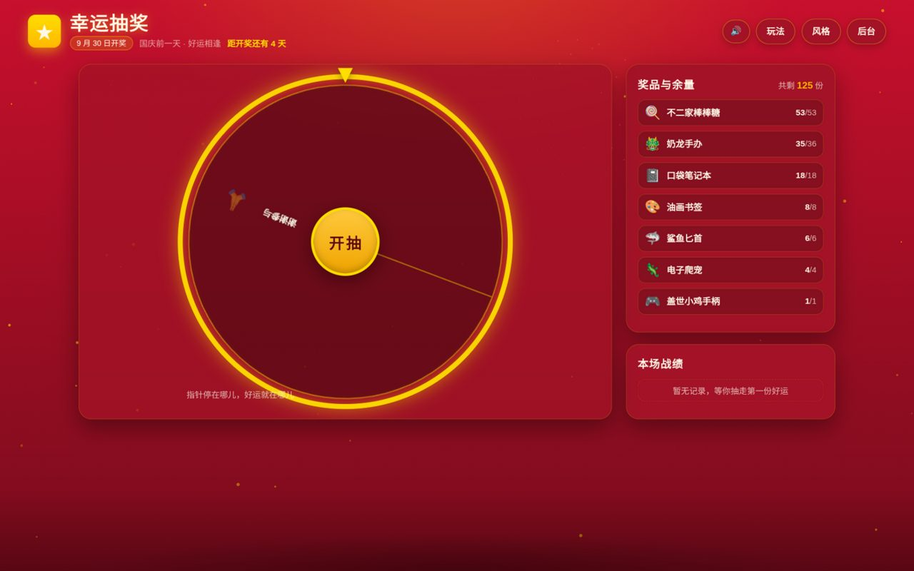
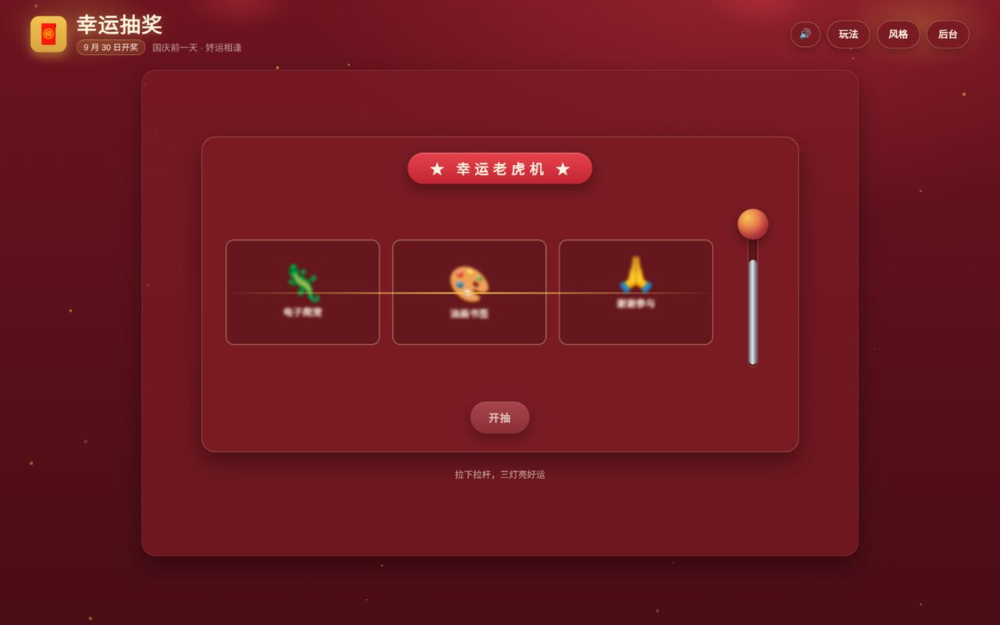

# Lucky Play · 多形式 × 多主题抽奖系统

[](https://github.com/HQU-AIot/lucky-play/actions/workflows/ci.yml)
[](LICENSE)


为线下活动准备的可自托管抽奖站：**2 种抽奖玩法 × 6 套视觉主题**，带概率后台、
奖品/库存全可编辑、谢谢参与动态概率转移。零外部资源（无 CDN/字体/图片素材），
离线可用——现场断网也能照抽不误。

| 大转盘（国庆盛典主题） | 老虎机（拉杆启动） |
| :---: | :---: |
|  |  |

## 目录

- [亮点](#亮点)
- [快速开始](#快速开始)
- [玩法与主题](#玩法与主题)
- [配置（环境变量）](#配置环境变量)
- [换奖品 / 接入自己的库存](#换奖品--接入自己的库存)
- [接口](#接口)
- [谢谢参与 · 动态概率](#谢谢参与--动态概率)
- [部署与安全](#部署与安全)
- [测试](#测试)
- [已知限制与路线图](#已知限制与路线图)
- [作者与维护状态](#作者与维护状态)
- [参与贡献](#参与贡献)
- [License](#license)

## 亮点

- **服务端定结果，前端只演动画**——概率完全由后台控制，改前端无法影响中奖结果；
- **并发不超卖**：抽奖在 `BEGIN IMMEDIATE` 事务内锁库存→抽取→扣减→落记录，
  每件发放都有流水可审计（16 线程抢 1 件大奖的并发测试保障）；
- **奖池全可编辑**：后台增删改奖品（名称/emoji/权重/库存/大奖标志），
  或用 JSON 清单整套播种自己的奖品，或实现 Inventory 协议接入自己的库存系统
  （见 [docs/CUSTOMIZE.md](docs/CUSTOMIZE.md)）；
- **动态概率转移**：奖品每被抽走一件，概率按比例让给"谢谢参与"，抽空恰好整体转移完；
- 零构建前端（原生 ES Module）、单文件 SQLite，一台笔记本即可承载全场。

## 快速开始

要求 Python ≥ 3.11，推荐用 [uv](https://docs.astral.sh/uv/)：

```bash
uv sync                                   # 安装依赖
uv run uvicorn app.main:app --port 8666   # 启动
```

打开 <http://127.0.0.1:8666> 抽奖页、<http://127.0.0.1:8666/admin> 后台（默认令牌 `123456`）。
没有 uv 时：`pip install "fastapi>=0.115" "uvicorn>=0.30"` 后同样 `uvicorn app.main:app` 启动。

运行测试：`uv run --no-config pytest -q`

## 玩法与主题

| 玩法 | 说明 |
| --- | --- |
| 🎡 大转盘 | Canvas 转盘：蓄力回拉 → 爆发 → 长减速直落中奖格，指针逐格弹跳 + tick 声 |
| 🎰 老虎机 | 三滚轮对对碰：全不同=没抽到；两同=×1；三同=×2；💎💎两钻=中奖者现场自选一件；💎💎💎三钻=超级大奖（后台可开关） |

**终极大奖**（默认为盖世小鸡手柄，可标记到任何奖品）：不进转盘、不出现在双钻自选、
不计入三钻超级大奖——三同大奖 = 大奖 + 随机一件其它奖品。

6 套主题（页面右上角实时切换，任一玩法 × 任一主题自由组合）：
`festive 红金福运` / `national 国庆盛典` / `neon 星空霓虹` / `macaron 云朵马卡龙` / `tech 未来科技` / `pixel 像素街机`。
设计细节见 [docs/DESIGN.md](docs/DESIGN.md)。

所有玩法支持**空格键**开始；结果弹窗打开时空格 = "再抽一次"，可全程一键连抽。

## 配置（环境变量）

| 变量 | 作用 | 默认 |
| --- | --- | --- |
| `LUCKY_DB` | SQLite 数据库路径 | `data/lucky.db` |
| `LUCKY_ADMIN_TOKEN` | 后台管理令牌 | `123456`（公网部署务必更换） |
| `LUCKY_PRIZES_JSON` | 自定义奖品清单（空库首次播种），格式见 [prizes.example.json](prizes.example.json) | 内置 8 件奖品 |
| `LUCKY_INVENTORY` | 外部库存实现 `模块:类名`（Inventory 协议） | 内置 SQLite Store |

## 换奖品 / 接入自己的库存

三条路由（改清单 / 后台编辑 / 实现 Inventory 协议接自己的后台）见
**[docs/CUSTOMIZE.md](docs/CUSTOMIZE.md)**，两分钟就能换成自己的奖品。

## 接口

公开：

| 接口 | 说明 |
| --- | --- |
| `GET /api/prizes` | 剩余奖品查询：`{event, prizes:[{id,name,emoji,remaining,total,is_grand}], total_remaining}` |
| `POST /api/draw` | 抽奖，body 可选 `{game:"wheel"\|"slot"}`（默认 wheel）。wheel 返回 `{result, prize, game}`；slot 另含 `prizes`（多件中奖明细）与 `symbols`（三轴符号，供动画对位） |
| `POST /api/slot/choose` | 双钻自选确认：`{token, prize_id}`（token 来自 slot 抽奖回执，一次性）。此刻才扣库存；奖品刚被抽走返回 409 可换一件重选 |
| `GET /api/sample?count=7` | 按当前概率采样展示结果（无副作用，不扣库存） |
| `GET /api/meta` | 活动名 / 开奖日期 / 老虎机开关 |

后台（请求头 `X-Admin-Token`）：

| 接口 | 说明 |
| --- | --- |
| `GET /api/admin/state` | 全量状态：奖品表（双权重/双概率/库存/大奖标志）、转移量、赔率面板 |
| `PUT /api/admin/weights` | 批量改两套权重 + 谢谢参与权重（slot_weights 可携带 `diamond`） |
| `PUT /api/admin/stock` | 改单奖品剩余/总量（剩余 ≤ 总量） |
| `POST /api/admin/prizes` | 新增奖品（满库存起步） |
| `PUT /api/admin/prizes/{id}` | 改名称 / emoji / 大奖标志 / 总量 |
| `DELETE /api/admin/prizes/{id}` | 删除奖品（有中奖记录会被拒，调零权重退出奖池） |
| `PUT /api/admin/dynamic` | 动态转移开关与模式（per_win / depleted） |
| `PUT /api/admin/slot` | 钻石权重、大奖上轴开关、三钻超级大奖开关 |
| `PUT /api/admin/win_stop` | 中奖音乐收刀位置（秒） |
| `PUT /api/admin/event` | 活动名 / 日期 / 副标 |
| `GET /api/admin/history?limit=` · `POST /api/admin/history/reset` | 抽奖流水查询 / 清空 |
| `POST /api/admin/replenish` | 全部补货（remaining = total） |

## 谢谢参与 · 动态概率

每个奖品两套独立权重：**转盘权重 W** 与**老虎机权重**（后台分别调节、互不影响），
库存（总量 S、剩余 R）共用：

- **per_win 每抽一件渐移（默认）**：奖品有效权重 `W×R/S`，每抽走一件即有一份概率
  让给谢谢参与，抽空时恰好整体转移完；
- **depleted 抽空才整移**：剩余期间权重不变，抽空后 W 全额让给谢谢参与；
- 后台改权重 / 补货即时生效，补货后已转移概率自动回流（公式由库存推导，无状态漂移）。

## 部署与安全

- 单进程部署：SQLite + RLock + `BEGIN IMMEDIATE` 保证原子扣减；双钻自选凭据在内存
  （30 分钟过期），不要开多进程实例指向同一库。
- **公网部署务必设置 `LUCKY_ADMIN_TOKEN`** 替换默认令牌，并置于反向代理 / 内网之后。
- 交接 / 运营手册（活动前检查清单、红线事项）：[docs/HANDOVER.md](docs/HANDOVER.md)。

## 测试

```bash
uv run --no-config pytest -q          # 62 项：概率数学 / API 集成 / 并发不超卖 / 抽干浸泡 / CRUD 与迁移
uv run scripts/prob_check.py          # 蒙特卡洛概率核查（走真实 HTTP API）
```

手工 GUI 测试清单与记录见 [docs/TESTING.md](docs/TESTING.md)。

## 目录结构

```
app/        FastAPI 后端：main.py 路由 · store.py SQLite 存储 · lottery.py 概率模型 · inventory.py 接入协议
web/        前端：index.html 抽奖页 · admin.html 后台 · js/ 逻辑 · css/ 主题皮肤
tests/      pytest 测试
examples/   外部库存接入示例
docs/       设计 / 交接 / 测试 / 定制指南
scripts/    launch.sh 一键启动 · package.sh 打包 · prob_check.py 概率验证
```

## 已知限制与路线图

已知限制：

- **单进程部署假定**：抽奖原子性靠 `RLock + BEGIN IMMEDIATE`、双钻凭据在内存——不要开多进程实例指向同一个数据库文件；
- **GUI 无自动化测试**：62 项 pytest 覆盖全部后端逻辑（概率/并发/迁移/CRUD），前端界面靠手工清单验证（[docs/TESTING.md](docs/TESTING.md)）；
- **背景音乐版权**：`web/assets/lucky-song.mp3` 为翻唱曲目，不随 MIT 许可授权分发，替换为你自己的 BGM（同名放入 `web/assets/`）即可；
- **默认管理令牌 123456**：仅限内网/可信场合，公网部署必须设置 `LUCKY_ADMIN_TOKEN`；
- 暂无英文 README。

路线图：

- [ ] 英文 README
- [ ] 前端冒烟自动化（Playwright 跑通"开抽→弹窗→再抽"主链路）
- [ ] 活动报表一键导出（CSV/xlsx：抽奖流水 × 奖品消耗交叉表）
- [ ] 奖品图片字段（当前用 emoji，扩展列 + 前端渲染三处）
- [ ] 多管理员令牌与操作审计日志

## 作者与维护状态

- 作者：[glong888](https://github.com/glong888)（[HQU-AIoT](https://github.com/HQU-AIot)）
- 维护状态：**可用（usable）**——62 项自动化测试全绿、CI 保障；已完整支撑过一次真实线下活动（2026-09-30 国庆游园会，280+ 条抽奖记录、并发抽奖不超卖）
- 适用场景：社团 / 班级 / 公司线下活动的单机抽奖站（笔记本或 kiosk 即可，断网可用）
- 运行环境：Windows / macOS / Linux；Python 3.11+（推荐 [uv](https://docs.astral.sh/uv/)）
- 反馈：欢迎在 [Issues](https://github.com/HQU-AIot/lucky-play/issues) 提交问题与需求；接入外部库存遇到契约疑问请附 `docs/CUSTOMIZE.md` 对应章节

## 参与贡献

欢迎提 Issue 或 PR，尤其是：

- 新的主题皮肤（`web/css/themes.css` 按既有 token 结构加一套）
- 新玩法挂载器（`web/js/forms/` 注册表模式：一个 `mount(stage, ctx)` 导出即可接入）
- 概率/并发边界的新测试用例
- 文档勘误与使用反馈

提交前请确认：

1. `uv run --no-config pytest -q` 全部通过；
2. 不包含真实活动数据、个人信息或内部部署细节（`data/` 已被 gitignore，请勿绕过）；
3. 改动涉及接口行为时同步更新 README 的 API 表与相关文档。

## License

[MIT](LICENSE)。背景音乐 `web/assets/lucky-song.mp3` 为翻唱曲目，仅本项目原活动内部使用，
不随 MIT 许可授权分发；替换为你自己的 BGM（同名放入 `web/assets/`）即可。

如果这个项目对你的活动有帮助，欢迎 Star ⭐
